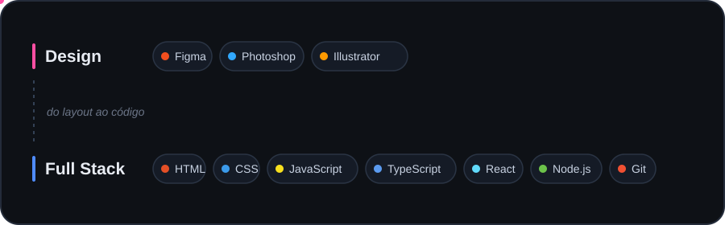

  

  
  

  
  

<h2>🧑‍💻 Sobre mim</h2>

Oi, eu sou o <b>Carusei</b>, de Santa Catarina. Estudo <b>Desenvolvimento Full Stack</b> e <b>Design</b> na <a href="https://ebaconline.com.br">EBAC</a>, e faço os dois cursos completos. Escolhi estudar as duas áreas juntas porque gosto de acompanhar uma ideia do começo ao fim: primeiro desenho como ela deve ser, depois escrevo o código que a coloca no ar.

No <b>Design</b>, aprendo a pensar em layout, cores, tipografia e na experiência de quem vai usar. No <b>Full Stack</b>, aprendo a construir o que fica na frente (as telas) e o que fica por trás (a lógica e os dados) para que tudo funcione de verdade. Ter as duas visões me ajuda a criar interfaces que, além de bonitas, são simples de usar e fáceis de manter.

Aqui no GitHub eu guardo os projetos que faço durante os cursos e os que crio por conta própria para praticar. Estou sempre estudando, errando, corrigindo e melhorando um commit de cada vez.

  🎨 Design e interfaces &nbsp;·&nbsp; 💻 Full Stack &nbsp;·&nbsp; 🌱 Evoluindo a cada commit &nbsp;·&nbsp; 🤝 Aberto a colaborações

<h2>🛠️ Tecnologias</h2>

  

<h2>🎨 Design e criação</h2>

  

Na formação de Design da EBAC eu aprendo a transformar uma ideia em algo visual e fácil de usar:

<ul>
  <li>Criação de layouts de sites e aplicativos, com hierarquia visual e organização clara.</li>
  <li>Escolha de cores, tipografia e identidade visual que combinem com o projeto.</li>
  <li>Protótipos e telas no Figma, pensando em como a pessoa vai navegar.</li>
  <li>Edição e criação de imagens e ilustrações no Photoshop e no Illustrator.</li>
  <li>Usabilidade e acessibilidade: interfaces que qualquer pessoa consegue entender.</li>
</ul>

  
  
  
  
  
  

<h2>💻 Desenvolvimento Full Stack</h2>

  

Na formação Full Stack da EBAC eu aprendo a construir sistemas completos, do que o usuário vê até o que acontece por trás:

<ul>
  <li>Páginas responsivas com HTML, CSS e JavaScript.</li>
  <li>Componentes e interfaces com React e TypeScript.</li>
  <li>Back-end com Node.js, criando APIs e regras de negócio.</li>
  <li>Versionamento e trabalho organizado com Git e GitHub.</li>
</ul>

  
  
  
  
  
  
  

<h2>🧠 Conhecimento além das ferramentas</h2>

<table>
  <tr><th align="left">Área</th><th align="left">O que aplico e estudo</th></tr>
  <tr><td><b>Design</b></td><td>Layout, hierarquia visual, cores, tipografia, grids e identidade visual</td></tr>
  <tr><td><b>Experiência do usuário</b></td><td>Usabilidade, acessibilidade, fluxos de navegação e protótipos no Figma</td></tr>
  <tr><td><b>Front-end</b></td><td>HTML semântico, CSS responsivo, JavaScript, TypeScript e React</td></tr>
  <tr><td><b>Back-end</b></td><td>Node.js, criação de APIs e regras de negócio</td></tr>
  <tr><td><b>Dados</b></td><td>Armazenamento, organização e consulta de informações</td></tr>
  <tr><td><b>Entrega</b></td><td>Git, GitHub, versionamento e documentação dos projetos</td></tr>
</table>

<h3>🚀 Em aprofundamento</h3>

<pre>
Design de interfaces  → telas claras, bonitas e consistentes
React e TypeScript    → componentes reutilizáveis e código mais seguro
APIs com Node.js      → comunicação entre o front-end e o back-end
Git e GitHub          → histórico organizado e trabalho em equipe
</pre>

<blockquote>Mais importante do que colecionar ferramentas é entender quando e por que usar cada uma delas.</blockquote>

<h2>✨ Projetos</h2>

Meus projetos do curso vão aparecer aqui conforme eu for publicando. 🚧

<h2>📊 Atividade e evolução</h2>

  

<h2>🐍 Contribuições em movimento</h2>

  <picture>
    <source media="(prefers-color-scheme: dark)" srcset="https://raw.githubusercontent.com/Caruseii/Caruseii/output/github-contribution-grid-snake-dark.svg" />
    <source media="(prefers-color-scheme: light)" srcset="https://raw.githubusercontent.com/Caruseii/Caruseii/output/github-contribution-grid-snake.svg" />
    
  </picture>

<h2>📫 Contato</h2>

  E-mail: <a href="mailto:contato.carusei@outlook.com">contato.carusei@outlook.com</a> 
  Discord: <b>carusei</b>

Feito com curiosidade, código e vontade de evoluir.

  

