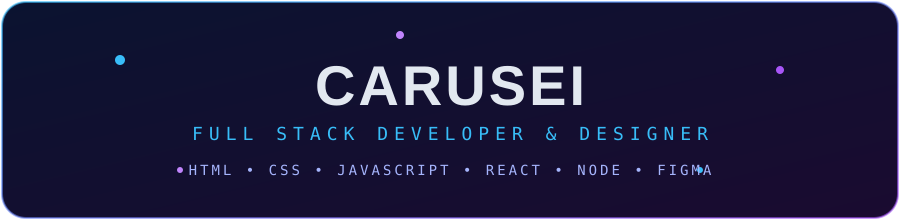

  
 
     
 <h2>Sobre mim</h2> 
Faço os cursos completos de <b>Full Stack</b> e de <b>Design</b> na <a href="https://ebaconline.com.br">EBAC</a>. Gosto de ver uma ideia sair do papel, passar pelo layout e virar um site que funciona.
 
 📍 Santa Catarina, Brasil &nbsp;&nbsp; 📫 <a href="mailto:contato.carusei@outlook.com">contato.carusei@outlook.com</a> &nbsp;&nbsp; 🤝 Aberto a colaborações 
 <h2>Tecnologias</h2> 
  
 <h2>Projetos</h2> 
Meus projetos do curso vão aparecer aqui conforme eu for publicando. 🚧

